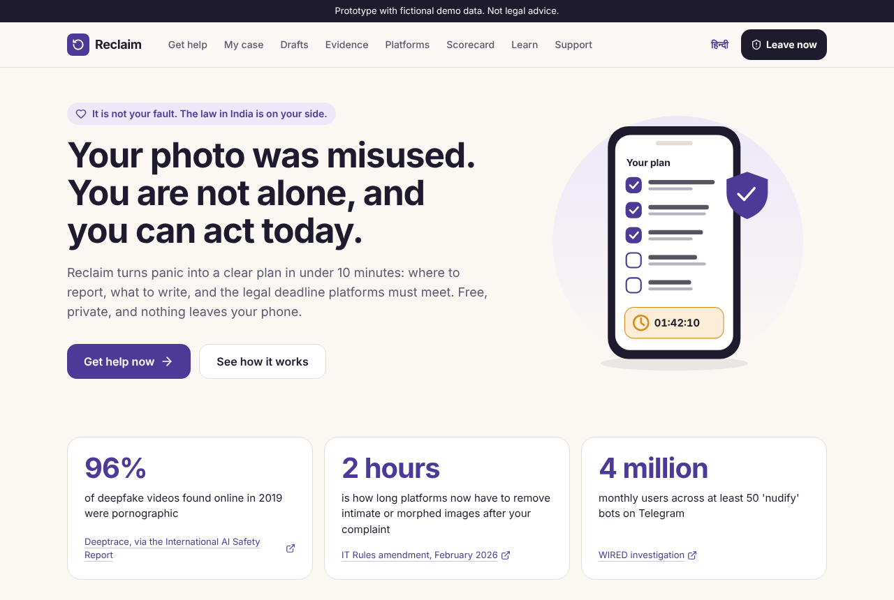
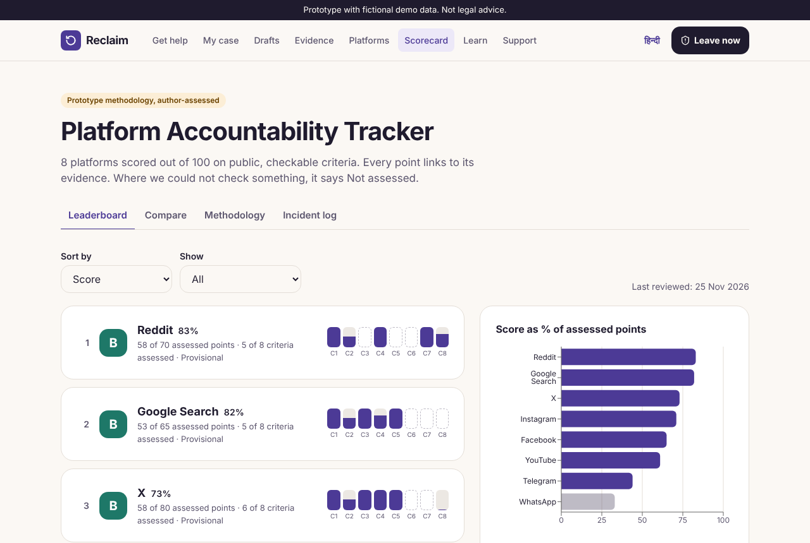
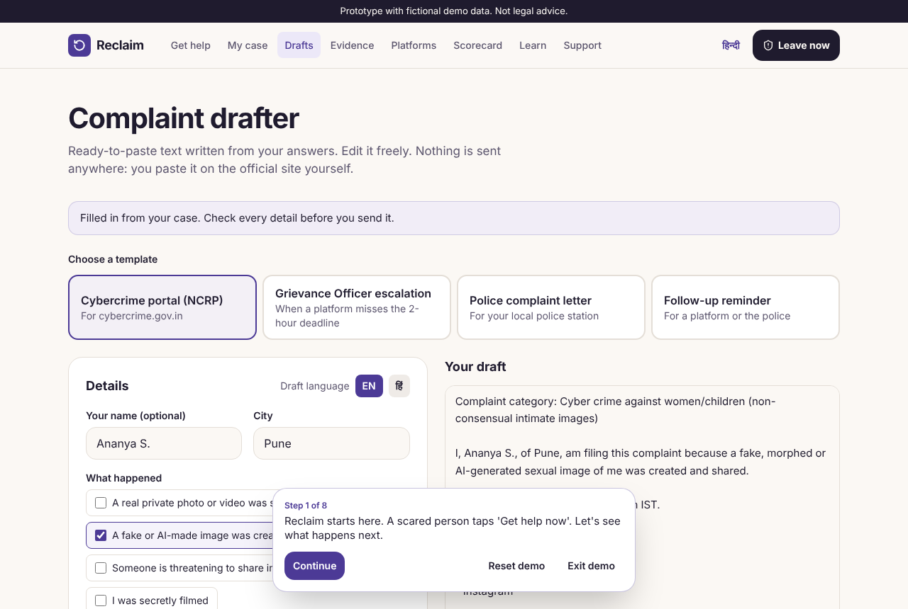
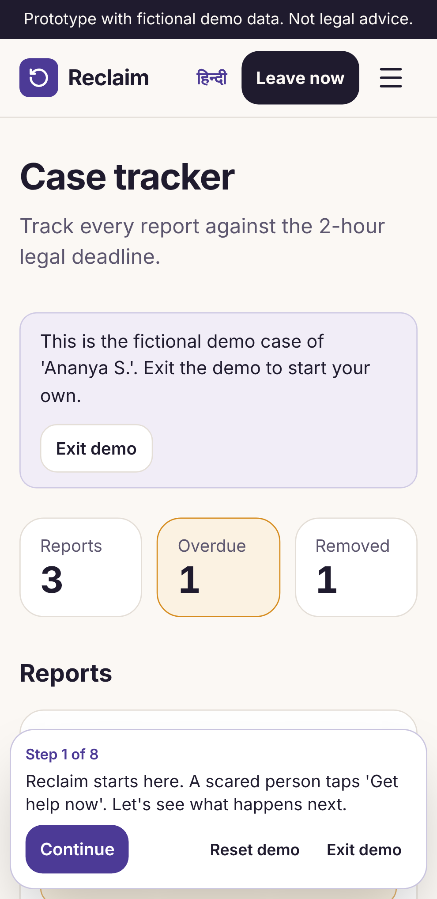

# Reclaim

**Know what to do, where to report, and which platforms are failing you.**

Reclaim is a free, privacy-first web app for people in India whose intimate, morphed or AI-generated images are shared online without consent. It turns panic into a clear action plan in under 10 minutes, and it publicly scores how well each platform protects victims.

> Prototype with fictional demo data. Not legal advice.



## The problem

Anyone with one clear photo online can now be turned into fake intimate content in minutes. A 2019 Deeptrace study found 96% of deepfake videos online were pornographic, and a WIRED investigation found at least 50 "nudify" bots on Telegram with about 4 million monthly users. India's law moved fast: since 20 February 2026, platforms must remove intimate or morphed images within **2 hours** of a complaint. But every platform has a different report form, most people have never heard of the 2-hour rule or a platform's India Grievance Officer, and shame stops people from asking for help.

## What it does

| Feature | What it gives you |
| --- | --- |
| Guided help flow | 8 simple questions, one per screen, every one skippable, that build a personal action plan |
| Action plan | An ordered checklist built by rules from your answers |
| Platform guides | Exact reporting steps, official forms and the Grievance Officer route for Instagram, Facebook, WhatsApp, Telegram, X, Reddit, YouTube and Google Search |
| Complaint drafter | Ready-to-paste text for cybercrime.gov.in, a Grievance Officer, the police and follow-ups, in English and Hindi, with Copy and PDF |
| Evidence kit | A safe checklist and a text-only evidence log with CSV and PDF export |
| Case tracker | A live countdown to the 2-hour legal deadline for every report, with one-tap escalation when it is missed |
| Accountability Tracker | A public scorecard of 8 platforms on 8 checkable criteria; every point links to its evidence |
| Learn hub | 12 plain-language guides in English and Hindi |
| Under-18 route | A hard stop that shows only official child-safety routes |
| Safety controls | Leave now button and Esc key, Delete everything, neutral tab title, optional PIN |
| Demo mode | A guided 3-minute tour of a fictional case |

| Scorecard | Drafter | Case tracker (mobile) |
| --- | --- | --- |
|  |  |  |

## Privacy by design

- No accounts, no database, no analytics, no cookies, no third-party scripts or fonts.
- Reclaim never asks for, uploads or stores any image. There is no file upload control anywhere.
- Everything a user types lives in one `localStorage` key (`reclaim:v1`) in their own browser. "Delete everything" removes it, and the app writes nothing at all until there is something to keep.
- Internal links replace the browser history entry, so after "Leave now" the Back button cannot return to the site.
- Strict security headers: Content-Security-Policy, HSTS, `X-Frame-Options: DENY`, `Referrer-Policy: no-referrer`, and a Permissions-Policy that blocks camera and microphone.

## Tech stack

| Layer | Choice |
| --- | --- |
| Framework | Next.js 15 (App Router), TypeScript, static export |
| UI | Tailwind CSS, shadcn-style components, Radix Dialog, lucide icons |
| State | Zustand with localStorage persistence |
| Content | Versioned JSON and Markdown, validated with Zod at build time |
| Languages | English and Hindi, route-level (`/hi/...`) |
| PDF | pdf-lib in the browser (Hindi uses the print dialog so the script renders correctly) |
| Dates | date-fns-tz, all times in IST |
| Tests | Vitest (unit) and Playwright with axe (end to end, desktop and 360 px) |
| Hosting | Vercel |

## Run it locally

```bash
npm install
npm run dev          # http://localhost:3000
npm test             # unit tests
npm run build        # validates content, then builds the static site into out/
npm run e2e          # end-to-end tests against the built site
npm run check-links  # checks every source link in the content
```

## Project layout

```
app/            Routes: app/(en)/... for English, app/hi/... for Hindi (thin wrappers)
src/views/      One component per page
src/components/ Shell, safety controls, dialogs, tour, UI primitives
src/lib/        Plan rules, deadline logic, scoring, store, schemas, PDF
content/        Platforms, legal, helplines, tracker scores and incidents, Learn articles, templates, UI strings
scripts/        Content validation, link checker, route generator, local server
tests/, e2e/    Vitest and Playwright suites
```

All guide, legal and tracker content lives in `content/`, so it can be corrected without touching code. Every legal, platform and helpline item carries a source link and a "last verified" date, and the build warns when anything is older than 90 days.

## Limits

Reclaim explains the law and points to official sources; it is not legal advice and does not file anything for anyone. The scorecard is a prototype methodology, author-assessed from public information, with "Not assessed" wherever something could not be checked. Hindi content is machine-assisted and marked "Translation under review". Review by a cyber-law expert and a survivor-support NGO is the first item on the roadmap.

## Corrections

Spotted an error in a score, a law or a helpline? Please [open an issue](https://github.com/kenil11shah/reclaim/issues/new) with a source.

## License

MIT
